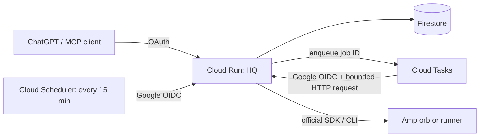

# Handoff: deploy HQ on Cloud Run

Deploy the current `origin/main` to the owner's Firebase/GCP project. Implemented
scope is lists + Amp + OAuth. Do not re-add other product features or deploy a VM,
Cloud SQL, Redis, a VPC connector, load balancer, Firebase Functions or an always-on
worker. This document prepares deployment; no GCP resources were provisioned by
the coding agent.

## Architecture and budget

One Cloud Run service handles OAuth/MCP and authenticated task requests.
Firestore Standard edition in Native mode stores all durable state. Cloud Tasks
holds job deliveries. One Cloud Scheduler job repairs unscheduled queued records,
expires abandoned leases and removes expired temporary records every 15 minutes.



Read [the cost model](../docs/COSTS.md). Recommend request-based billing,
**minimum 0 / maximum 1**, 1 vCPU, 1 GiB memory, concurrency 8 and a 1500-second
request timeout. Task dispatch concurrency must be 1. A long worker request can
share the service with MCP requests. No instance scaling settings are encoded in
this repository: apply the owner's chosen limits locally. A minimum of 1 incurs
idle charges and is unlikely to meet a strict few-dollars budget.

The default limits are ten admissions per UTC day, a ten-minute observation
window per job, and 1800 seconds of observation reservations per UTC day. These
limits bound HQ observation, not remote Amp credit usage. Do not raise them
without considering the owner's budget. Billing alerts are notifications, not a
hard spending cap.

## Inputs and local configuration

Use the owner's existing authenticated Google CLI/Firebase setup. Identify the
project and region without dumping credentials or environment values. Prefer
one existing Firebase/GCP project with billing enabled, using one region for
Cloud Run, Tasks, Scheduler, Artifact Registry and the Firestore regional database.
Examples below use `us-central1`; choose a different region consistently if needed.

Set task-specific shell variables `HQ_PROJECT`, `HQ_REGION`, and `HQ_IMAGE`.
Use `--project` explicitly; do not overwrite unrelated default CLI profiles.
Copy `deploy/env.example.yaml` to ignored `deploy/env.local.yaml`, replace every
`REPLACE_*` value and choose `TIME_ZONE`. Keep all secret values out of that file.

Enable `run.googleapis.com`, `firestore.googleapis.com`,
`cloudtasks.googleapis.com`, `cloudscheduler.googleapis.com`,
`secretmanager.googleapis.com`, `artifactregistry.googleapis.com` and
`cloudbuild.googleapis.com`. If Firestore already exists, inspect and reuse it;
its location cannot be casually changed. Use the default database `(default)`
in **Standard / Native** mode, not Datastore mode or MongoDB compatibility.

Use a dedicated HQ project if possible. In a shared project, merge the HQ rules
and indexes into the existing configuration; never overwrite unrelated apps'
rules. Existing wildcard grants must not expose the chosen HQ prefix.

For a dedicated project, deploy the supplied indexes and deny-all client rules with the owner's
Firebase CLI, e.g. `firebase deploy --only firestore --project "$HQ_PROJECT"`.
The server uses IAM and bypasses client rules intentionally. Do not enable public
Firebase client reads/writes. The large `body` and `id` fields are excluded from
indexing. Wait for the two composite indexes to be ready before testing list pages.

## Identities and secrets

Create or reuse dedicated `hq-runtime` and `hq-tasks` service accounts.
Set `TASKS_SERVICE_ACCOUNT` to the exact hq-tasks email in the private env file.

| Identity | Required access |
| --- | --- |
| `hq-runtime` | `roles/datastore.user` on the project; `roles/cloudtasks.enqueuer`; `roles/iam.serviceAccountUser` on hq-tasks; `roles/secretmanager.secretAccessor` on only HQ's secrets |
| `hq-tasks` | Used as the task/scheduler OIDC identity; no Firestore or secret access needed |
| Cloud Tasks managed service agent | Its normal `roles/cloudtasks.serviceAgent` role, including OIDC minting |
| Cloud Scheduler managed service agent | Its normal `roles/cloudscheduler.serviceAgent` role, including OIDC minting |
| Local deployer / build identity | Normal build, Artifact Registry, deploy and act-as access for these resources; do not give runtime Owner/Editor |

Use attached runtime identity / Application Default Credentials. Do not create
or bundle a service-account JSON key. The task creator must be allowed to act as
hq-tasks. Fix missing managed-agent roles using official setup instructions;
do not work around missing access with shared secret headers.

Create Secret Manager entries for `OWNER_PASSWORD_HASH` and `COOKIE_SECRET`,
and `AMP_API_KEY` when available. Generate the first with `npm run password`,
and the second with `openssl rand -hex 32`, privately. Keep the cookie secret
stable because it encrypts stored confidential OAuth client secrets. Grant access
to the runtime account at the secret level. Reference specific secret versions
through `--set-secrets`; never print their values or put them in Git/build args.
Leave Amp disabled until its private account token and remote target are ready.

## Build and first deployment

Create/reuse a regional Docker Artifact Registry repository named `hq`.
Build a commit-tagged image from the provided Dockerfile, for example:

```sh
HQ_IMAGE="$HQ_REGION-docker.pkg.dev/$HQ_PROJECT/hq/hq:$(git rev-parse --short HEAD)"
gcloud builds submit --project "$HQ_PROJECT" --region "$HQ_REGION" --tag "$HQ_IMAGE" .
```

The Docker and Cloud Build context allowlists exclude `.env`, private config,
credentials, data, Git history and docs. The image runs as the non-root `node`
user. Its writable `/tmp` is needed for the Amp CLI's extracted native libraries;
do not make that location `noexec`. There is no local database in the image.

Deploy the image using the runtime service account and private env file, secret
references, request-based CPU allocation (`--cpu-throttling`), 1 CPU / 1 GiB,
concurrency 8, timeout 1500s, and the owner's scaling settings. Keep ingress open
for ChatGPT and Tasks. **Disable Cloud Run's Invoker IAM check** using
`--no-invoker-iam-check`: HQ's OAuth protects `/mcp`, and the app independently
verifies Google's full signed OIDC token for `/internal/*`. Do not put Cloud Run
IAM/IAP in front of the custom ChatGPT OAuth bearer tokens, or configure a proxy
that strips the internal token's signature. If an organization policy forbids
this access mode, report the limitation rather than disabling app authentication.

For the first deployment, a valid temporary `PUBLIC_URL=https://example.invalid`
with `AMP_ENABLED=false` is enough to obtain a service URL. Then get the actual
URL using `gcloud run services describe hq --project "$HQ_PROJECT" --region
"$HQ_REGION" --format='value(status.url)'`, set `PUBLIC_URL` to that exact origin
in the private env file, and update the service. Do not guess its hostname.
Confirm the runtime sees `K_SERVICE`, `STORAGE_BACKEND=firestore`, and
`JOB_BACKEND=cloudtasks`. It intentionally refuses memory storage on Cloud Run.

## Queue and recovery schedule

Create/reuse `hq-amp` in the same region. Configure the full resource name in
`CLOUD_TASKS_QUEUE`. Recommended queue settings:

```sh
gcloud tasks queues create hq-amp --project "$HQ_PROJECT" --location "$HQ_REGION" \
  --max-concurrent-dispatches=1 --max-dispatches-per-second=1 \
  --max-attempts=30 --max-retry-duration=24h --min-backoff=30s --max-backoff=300s
```

Use `queues update` for an existing queue. Do not create queue-level routing or
auth overrides; the application supplies the target, OIDC identity, audience and
a timeout-plus-120-seconds deadline on each task. A task body contains only a
job ID, never a prompt or credential. Actual Amp execution is claimed once in a
Firestore transaction. Duplicate deliveries may retry HTTP, but do not rerun a
claimed Amp prompt. Expired worker leases become interrupted/unknown.

Create **one** Scheduler job calling `POST $PUBLIC_URL/internal/maintenance`
every 15 minutes with body `{}`, OIDC service account hq-tasks, and OIDC audience
**exactly `$PUBLIC_URL` without a trailing slash or path**. This is required for
recovery if a process crashes between the Firestore commit and task creation;
request retries also repair that gap. Example:

```sh
gcloud scheduler jobs create http hq-maintenance --project "$HQ_PROJECT" \
  --location "$HQ_REGION" --schedule='*/15 * * * *' --time-zone=UTC \
  --uri="$PUBLIC_URL/internal/maintenance" --http-method=POST --message-body='{}' \
  --oidc-service-account-email="$HQ_TASKS_EMAIL" --oidc-token-audience="$PUBLIC_URL" \
  --attempt-deadline=180s
```

Set the local `PUBLIC_URL` and `HQ_TASKS_EMAIL` variables from the verified
private configuration before using that example. The app checks JWT signature,
issuer, expiry, audience, verified email and exact service-account email.
`X-CloudTasks-*` headers alone never grant access. Unknown or expired deliveries
are acknowledged only after checking durable state. Scheduled requests cost
only their short execution time; no process runs between them.

## Finish and verify

- Run `npm run verify`; run with a local Firestore emulator as CI does to include
  the real persistence/concurrency checks. `scripts/wait-emulator.mjs` waits on port 8787.
- Public `/healthz` should be 200 and contain no private data. `/mcp` and both
  internal routes should return 401 without the correct credentials.
- Connect the actual MCP client using its exact callback in
  `OAUTH_REDIRECT_URIS`. Complete owner consent, add/read/complete a synthetic
  list item, and verify state and an OAuth grant survive an instance/revision change.
- Run the Scheduler job once and confirm it succeeds with the real Google OIDC
  token. Forged task headers or a normal MCP bearer must remain unauthorized there.
- Configure the private Amp project or named runner, enable Amp, and test an
  owner-requested harmless job. Confirm it goes queued → running → terminal,
  survives a cold start before delivery, and the same retry key never doubles work.
  Never call an interrupted job remotely completed without fresh evidence.
- Apply `deploy/artifact-cleanup.json` to the Artifact Registry repository
  (retains two recent versions and removes old ones after seven days). Keep the
  owner-authorized budget alert around $3–5 and inspect actual billing after a week.
  Do not enable paid Firestore TTL/PITR, vulnerability scanning add-ons, verbose
  work-content logs or an always-on CPU policy for this small deployment.

Return the actual MCP URL, region/project, secret *names/versions*, applied
scaling/billing settings, queue + scheduler status, smoke-test results and anything
still unverified. Do not include secret values or private work output. The user's
voice-client compatibility still needs testing on their actual phone/client.
